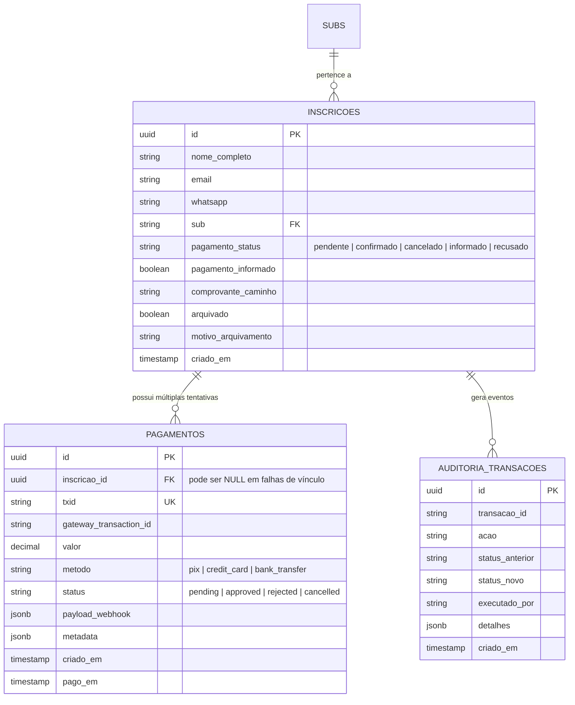

# RELATÓRIO 2 — ARQUITETURA TÉCNICA DO SITE E COMPARAÇÃO COM A VERCEL
## EJC TRÂNSITO MONTE SIÃO — ENGENHARIA DE SOFTWARE, INFRAESTRUTURA E FLUXOS OPERACIONAIS

**Data da Perícia:** 07 de Novembro de 2026  
**Ambiente Analisado:** Produção Ativa (Cloudflare Pages + Workers + Supabase Edge Functions + PostgreSQL) vs Backup Histórico Vercel  
**Regime Operacional:** Estritamente Somente Leitura (*Read-Only*) — Sem alterações de código, infraestrutura ou deploy.

---

### SUMÁRIO EXECUTIVO

Este relatório documenta detalhadamente a arquitetura de software, a infraestrutura em nuvem, os mecanismos de segurança e os fluxos de dados do site **EJC Trânsito Monte Sião**, confrontando a implementação atual com a arquitetura histórica do período em que o sistema operava na plataforma Vercel.

**Pontos Críticos de Engenharia Identificados:**
1. **Desacoplamento em Três Níveis:** A aplicação evoluiu de um monolito *serverless* na Vercel para uma arquitetura distribuída composta por: (a) Distribuição Estática e Proxy de Borda na Cloudflare Pages (`cloudflare-public-dist` e `cloudflare-admin-dist`); (b) Funções de Borda no Supabase Deno Edge Functions; e (c) Banco Relacional PostgreSQL 15 com Row Level Security (RLS) e RPCs atômicas.
2. **Encaminhamento de Borda e Desativação da Vercel:** O arquivo de borda `_worker.js` intercepta todas as chamadas `/api/*`. O tráfego para `/api/checkout-process` é governado pela variável de ambiente `FEATURE_FLAG_CHECKOUT_PROCESS_EDGE` (cujo padrão em produção é autoritativamente `'ON'`), despachando 100% das operações para o Supabase Edge. Endpoints legados da Vercel retornam código `404` com aviso de descontinuação, comprovando que **a Vercel não atende mais o tráfego de produção ativo**.
3. **Causa Raiz Estrutural das Falhas de Checkout:** O problema de busca de inscrições (que impediu a participante Luísa Barreto de localizar seu registro após uma recusa de cartão) foi uma **regra restritiva herdada integralmente da Vercel** (`api/checkout-process.js`, linha 638), que filtra exclusivamente `.in("pagamento_status", ["pendente", "cancelado"])`, excluindo o estado `recusado`.
4. **Vulnerabilidade de Divergência Tipográfica:** Como o checkout permite o preenchimento manual de e-mail na finalização do pagamento, inconsistências de digitação quebram o casamento de chaves no Supabase, gerando transações aprovadas órfãs (`inscricao_id IS NULL`).

---

### A. VISÃO GERAL DA ARQUITETURA ATUAL

#### A.1. Diagrama de Topologia de Infraestrutura

```mermaid
flowchart TD
    subgraph Clientes ["Clientes (Navegadores & Dispositivos Móveis)"]
        UserPublic["Usuário Público\n(transitoejc.site)"]
        UserAdmin["Coordenador / Admin\n(ejc-admin.pages.dev)"]
    end

    subgraph Cloudflare ["Camada de Borda — Cloudflare Pages & Workers"]
        CF_Public["Cloudflare Pages: Público\n(cloudflare-public-dist)"]
        Worker_Public["Worker de Borda (_worker.js)\nProxy /api/* & Roteamento"]
        CF_Admin["Cloudflare Pages: Admin\n(cloudflare-admin-dist)"]
        Worker_Admin["Worker Admin (_worker.js)\nProxy /api/admin/*"]
        R2_Bucket["Cloudflare R2 Storage\n(Fotos de Participantes)"]
    end

    subgraph Supabase ["Backend — Supabase (Projeto: guppedddwnuvluhiaaas)"]
        Edge_Checkout["Edge Function: checkout-process"]
        Edge_SubCounts["Edge Function: sub-counts"]
        Edge_Config["Edge Function: public-config"]
        Edge_Verify["Edge Function: verificar-inscricao"]
        Edge_Webhook["Edge Function: pix-webhook"]
        Edge_AdminRead["Edge Function: admin-read"]
        Edge_AdminWrite["Edge Function: admin-write"]
        Postgres_DB[(PostgreSQL 15\nTabelas, RLS & RPCs)]
        Supabase_Storage["Supabase Storage\n(fotos / inscritos-fotos)"]
    end

    subgraph Externos ["Provedores Externos"]
        MP_Gateway["Mercado Pago API\n(Pix & Card Brick Direct)"]
        Brevo_SMTP["Brevo (Sendinblue)\nAPI v3 / SMTP Relay"]
    end

    UserPublic -->|Acesso Web / Inscrição| CF_Public
    CF_Public --> Worker_Public
    UserAdmin -->|Painel Administrativo| CF_Admin
    CF_Admin --> Worker_Admin

    Worker_Public -->|Proxy /api/checkout-process| Edge_Checkout
    Worker_Public -->|Proxy /api/sub-counts| Edge_SubCounts
    Worker_Public -->|Proxy /api/config| Edge_Config
    Worker_Public -->|Proxy /api/verificar-inscricao| Edge_Verify
    Worker_Public -->|Proxy /api/pix-webhook| Edge_Webhook
    Worker_Public -->|Upload Direto de Fotos| R2_Bucket

    Worker_Admin -->|Proxy /api/admin/inscritos-dados| Edge_AdminRead
    Worker_Admin -->|Proxy /api/admin/inscritos-dados (PATCH)| Edge_AdminWrite

    Edge_Checkout -->|Transações & Vagas| Postgres_DB
    Edge_SubCounts -->|Inscrições & Contagens| Postgres_DB
    Edge_Verify -->|Validação de Dados| Postgres_DB
    Edge_Webhook -->|Conciliação de Pagamentos| Postgres_DB
    Edge_AdminRead -->|Leitura Autenticada| Postgres_DB
    Edge_AdminWrite -->|Modificações Administrativas| Postgres_DB

    Edge_Checkout -->|Cobrança Pix / Token Cartão| MP_Gateway
    MP_Gateway -->|Webhooks de Pagamento| Edge_Webhook
    Edge_Checkout -->|Envio de Recibos| Brevo_SMTP
```

#### A.2. Domínios, Projetos e Separação de Ambientes
- **Domínio Público Principal:** `https://www.transitoejc.site` (e alias canônico `https://transitoejc.site`). Hospedado no projeto Cloudflare Pages alimentado pelo diretório de build `cloudflare-public-dist/`.
- **Painel Administrativo:** `https://ejc-admin.pages.dev` (isolado do site público). Hospedado no Cloudflare Pages alimentado por `cloudflare-admin-dist/`. Qualquer acesso direto a `transitoejc.site/admin` é redirecionado via regra 302 no Worker para `https://ejc-admin.pages.dev`.
- **Backend Supabase:** Projeto de referência `guppedddwnuvluhiaaas` no datacenter AWS (região São Paulo / sa-east-1). Hospeda as Edge Functions e a instância PostgreSQL.
- **Armazenamento de Mídia:** Cloudflare R2 para fotos enviadas pelos inscritos, com fallback configurado para os buckets `fotos` e `inscritos-fotos` do Supabase Storage.
- **Serviços Externos de Produção:**
  - Gateway de Pagamento: Mercado Pago (Credenciais de Produção sob as chaves `MERCADO_PAGO_ACCESS_TOKEN` e `MERCADO_PAGO_PUBLIC_KEY`).
  - Mensageria Transacional: Brevo API v3 (`BREVO_API_KEY`).

---

### B. FRONTEND E EXPERIÊNCIA DO USUÁRIO

#### B.1. Páginas Públicas Principais
- [index.html](file:///d:/Documentos/Projetos/SITE%20EJC/index.html): Landing page oficial. Contém formulário de inscrição, seleção de subgrupos (Verde, Vermelho, Amarelo, Laranja), contadores regressivos para as reuniões com sorteio de fichas (dias 11, 18 e 25 de novembro), seção informativa "Transiteiro", docking de contadores ao calendário e rodapé com links oficiais.
- [checkout.html](file:///d:/Documentos/Projetos/SITE%20EJC/checkout.html): Página de pagamento unificada. Implementa:
  - Busca e recuperação de inscrições pendentes (`action=buscar_inscricoes`).
  - Checkout Pix nativo com geração de QR Code e chave copia-e-cola via polling de status.
  - Checkout Transparente de Cartão de Crédito via biblioteca oficial **Mercado Pago Card Payment Brick**, com suporte a parcelamento e cálculo dinâmico de taxas.
- [verificar-inscricao.html](file:///d:/Documentos/Projetos/SITE%20EJC/verificar-inscricao.html): Interface pública de autoatendimento. Permite conferência de status cadastral e financeiro por combinação de 3 dados normalizados (Nome, E-mail e WhatsApp), com funcionalidade para envio manual de comprovante bancário caso o participante tenha pago por transferência.
- [checkout-retorno.html](file:///d:/Documentos/Projetos/SITE%20EJC/checkout-retorno.html) e [confirmacao-pagamento.html](file:///d:/Documentos/Projetos/SITE%20EJC/confirmacao-pagamento.html): Telas de recibo e sucesso pós-transação.

#### B.2. Gerenciamento de Tema, Assets e Cache
- **Tema Claro/Escuro:** Gerenciado pelo script [js/theme.js](file:///d:/Documentos/Projetos/SITE%20EJC/js/theme.js) com persistência em `localStorage` e sincronização automática com o `prefers-color-scheme` do sistema operacional.
- **Docking de Contadores:** O script [js/script.js](file:///d:/Documentos/Projetos/SITE%20EJC/js/script.js) calcula o scroll e ancora o contador flutuante diretamente no card correspondente na seção Calendário quando visível na viewport, ocultando o flutuante para evitar poluição visual.
- **Cabeçalhos de Cache:** O arquivo [_headers](file:///d:/Documentos/Projetos/SITE%20EJC/cloudflare-public-dist/_headers) define `Cache-Control: no-cache, no-store, must-revalidate` para arquivos HTML e chamadas de API, garantindo que o navegador sempre consuma a versão mais recente após cada build.

---

### C. ROTEAMENTO DE BORDA, PROXY E APIS

#### C.1. Mecanismo de Borda do Cloudflare Pages (`_worker.js`)
O roteador de borda [cloudflare-public-dist/_worker.js](file:///d:/Documentos/Projetos/SITE%20EJC/cloudflare-public-dist/_worker.js) atua como um *Reverse Proxy* transparente e seguro.

```mermaid
flowchart TD
    Req["Requisição HTTP do Cliente"] --> CheckAdmin{"Caminho é /admin*?"}
    CheckAdmin -->|Sim| RedirAdmin["Redirect 302 -> ejc-admin.pages.dev"]
    
    CheckAdmin -->|Não| CheckAPI{"Caminho inicia com /api/*?"}
    
    CheckAPI -->|Não| ServeAssets["env.ASSETS.fetch(request)\n(Serve HTML, CSS, JS estático da Cloudflare)"]
    
    CheckAPI -->|Sim| CheckRoute{"Qual é a rota da API?"}
    
    CheckRoute -->|/api/checkout-process| CheckFlag{"Feature Flag:\nFEATURE_FLAG_CHECKOUT_PROCESS_EDGE"}
    CheckFlag -->|ON (Padrão)| ProxyCheckout["Proxy para Supabase Edge:\n/functions/v1/checkout-process"]
    CheckFlag -->|OFF| ProxyLegacy["Fallback para Vercel Legacy:\nhttps://transitoejc.site"]
    
    CheckRoute -->|/api/sub-counts| ProxySub["Proxy para Supabase Edge:\n/functions/v1/sub-counts"]
    CheckRoute -->|/api/config| ProxyConfig["Proxy para Supabase Edge:\n/functions/v1/public-config"]
    CheckRoute -->|/api/verificar-inscricao| ProxyVerify["Proxy para Supabase Edge:\n/functions/v1/verificar-inscricao"]
    CheckRoute -->|/api/pix-webhook| ProxyWebhook["Proxy para Supabase Edge:\n/functions/v1/pix-webhook"]
    CheckRoute -->|Outras /api/* não migradas| Return404["Retorna 404:\n'Endpoint legado descontinuado'"]
```

#### C.2. Tabela de Mapeamento de Roteamento de APIs

| Rota Exposta ao Frontend | Destino Upstream no Supabase Edge | Método | Autenticação / Injeção de Headers |
| :--- | :--- | :---: | :--- |
| `/api/checkout-process` | `https://guppedddwnuvluhiaaas.supabase.co/functions/v1/checkout-process` | `GET`, `POST` | Injeta `apikey` pública; remove headers de depuração do cliente. |
| `/api/sub-counts` | `https://guppedddwnuvluhiaaas.supabase.co/functions/v1/sub-counts` | `GET`, `POST` | Injeta `apikey` pública. |
| `/api/config` | `https://guppedddwnuvluhiaaas.supabase.co/functions/v1/public-config` | `GET` | Injeta `apikey` pública. |
| `/api/verificar-inscricao` | `https://guppedddwnuvluhiaaas.supabase.co/functions/v1/verificar-inscricao` | `GET`, `POST` | Injeta `apikey` pública. |
| `/api/pix-webhook` | `https://guppedddwnuvluhiaaas.supabase.co/functions/v1/pix-webhook` | `POST` | Preserva cabeçalhos do Mercado Pago para validação de assinatura. |
| `/api/whatsapp` | `https://guppedddwnuvluhiaaas.supabase.co/functions/v1/whatsapp` | `GET` | Redirecionamento dinâmico para links oficiais dos grupos. |
| `/api/email-comprovante` | `https://guppedddwnuvluhiaaas.supabase.co/functions/v1/checkout-process` | `POST` | Injeta `action: "resend_receipt"`. |

---

### D. BACKEND E ESTRUTURA DE DADOS

#### D.1. Catálogo de Edge Functions no Supabase

| Nome da Edge Function | Arquivo de Origem | Responsabilidade Técnica Principal |
| :--- | :--- | :--- |
| **`checkout-process`** | `supabase/functions/checkout-process/index.ts` | Criação de intenções Pix, processamento direto de token de cartão, busca de inscrições pendentes (`buscar_inscricoes`), cancelamento, reconciliação resiliente e disparo de e-mails transacionais. |
| **`sub-counts`** | `supabase/functions/sub-counts/index.ts` | Consulta pública de contagem de inscritos por Sub (com verificação de capacidade) e criação de novas inscrições a partir do formulário da landing page. |
| **`verificar-inscricao`**| `supabase/functions/verificar-inscricao/index.ts` | Validação de dados por múltiplos fatores, upload de comprovantes manuais e emissão de tokens de acesso HMAC temporários. |
| **`pix-webhook`** | `supabase/functions/pix-webhook/index.ts` | Recepção assíncrona de notificações de pagamento do Mercado Pago, reconciliação idempotente e liquidação automática da inscrição. |
| **`public-config`** | `supabase/functions/public-config/index.ts` | Exposição pública das configurações de lotes, valores base e taxas ativas. |
| **`admin-read`** | `supabase/functions/admin-read/index.ts` | Consulta autenticada de inscritos, relatórios financeiros e contagens operacionais do painel administrativo. |
| **`admin-write`** | `supabase/functions/admin-write/index.ts` | Atualização cadastral, deferimento/indeferimento de comprovantes manuais e reajustes manuais de capacidade de Sub por superadmin. |
| **`send-email`** | `supabase/functions/send-email/index.ts` | Disparo desacoplado de e-mails transacionais via API v3 da Brevo. |
| **`r2-presigned-url`** | `supabase/functions/r2-presigned-url/index.ts` | Geração de URLs pré-assinadas S3/R2 para leitura e gravação segura de fotos de participantes. |

#### D.2. Modelo Relacional e Segregação de Estados

Uma premissa de governança essencial do projeto é a **distinção estrita entre o Estado da Inscrição e o Estado da Transação**:



- **`inscricoes.pagamento_status`:** Representa a situação cadastral do participante perante o evento (`pendente`, `confirmado`, `cancelado`, `informado`, `recusado`).
- **`pagamentos.status`:** Representa o ciclo de vida bancário de uma transação específica no gateway (`pending`, `approved`, `rejected`, `cancelled`).
- **Relação 1:N:** Um participante pode ter múltiplos registros na tabela `pagamentos` (ex.: um Pix cancelado por expiração, uma tentativa de cartão recusada pelo antifraude e uma tentativa posterior aprovada).

---

### E. FLUXOS DE PAGAMENTO E PREVENÇÃO DE DUPLICIDADE

#### E.1. Fluxo Pix Dinâmico Oficial
1. **Geração:** O checkout invoca `/api/checkout-process` com `metodo: "pix"`. A Edge Function gera um `txid` único (ex.: `PIXMW...`) e submete requisição `POST /v1/payments` ao Mercado Pago com `notification_url` apontando para o webhook canônico.
2. **Ciclo de Expiração:** O frontend exibe contagem regressiva de 15 minutos baseada no campo `expiracao` gravado no banco. Na API do Mercado Pago, a expiração padrão do Pix é concedida em 24 horas (`date_of_expiration`).
3. **Liquidação e Webhook:** Quando o participante transfere o valor, o Mercado Pago notifica `/api/pix-webhook`. O webhook executa a RPC `confirmar_pagamento_unificado`, atualizando atomicamente `pagamentos.status = 'approved'` e `inscricoes.pagamento_status = 'confirmado'`, disparando o e-mail de recibo.

#### E.2. Fluxo de Cartão de Crédito Transparente (Card Brick)
1. **Tokenização Segura no Navegador:** O participante digita os dados do cartão diretamente no componente oficial do Mercado Pago no cliente. O SDK do Mercado Pago gera um `cardToken` efêmero nos servidores do gateway, sem que os dados do cartão trafeguem ou sejam gravados na infraestrutura do EJC.
2. **Submissão à Edge Function:** O frontend envia o `cardToken`, número de parcelas e dados de identificação para `/api/checkout-process`.
3. **Persistência Prévia e Processamento:** A Edge Function persiste previamente a transação como `pending` para rastreabilidade de antifraude e executa `POST /v1/payments` no Mercado Pago.
4. **Tratamento de Resultados:**
   - **`approved`:** A inscrição é confirmada imediatamente via [confirmarPagamentoResiliente](file:///d:/Documentos/Projetos/SITE%20EJC/supabase/functions/checkout-process/index.ts#L629), retornando confirmação ao usuário.
   - **`rejected`:** A transação é gravada como `rejected` (com o motivo detalhado: `cc_rejected_high_risk`, `cc_rejected_insufficient_amount`, etc.) e a inscrição é atualizada para `recusado`.

#### E.3. Fluxo de Comprovantes Manuais (Status `informado`)
- Quando o participante efetua depósito ou transferência fora do checkout, ele utiliza a interface de [verificar-inscricao.html](file:///d:/Documentos/Projetos/SITE%20EJC/verificar-inscricao.html) para anexar o comprovante.
- O sistema grava `inscricoes.pagamento_informado = true`, `comprovante_caminho` com o caminho no storage e altera `pagamento_status = 'informado'`.
- **Regra Crítica de Negócio:** A inscrição permanece aguardando auditoria visual humana pela coordenação no painel administrativo. Não há liquidação bancária automática nesse fluxo.

---

### F. SERVIÇOS EXTERNOS E GESTÃO DE SEGREDOS

#### F.1. Matriz de Serviços e Integrações

| Serviço / Provedor | Função Operacional | Mecanismo de Integração | Variáveis de Configuração Requeridas |
| :--- | :--- | :--- | :--- |
| **Mercado Pago** | Gateway de pagamentos (Pix e Cartão). | SDK REST API v1 e Webhooks assinados. | `MERCADO_PAGO_ACCESS_TOKEN`, `MERCADO_PAGO_PUBLIC_KEY` |
| **Brevo (Sendinblue)** | Mensageria transacional e comprovantes. | HTTPS API v3 (`/v3/smtp/email`) e SMTP Relay. | `BREVO_API_KEY`, `BREVO_SENDER_EMAIL` |
| **Cloudflare R2** | Bucket de fotos de participantes. | API S3-Compatible com assinaturas SigV4. | `CLOUDFLARE_R2_ACCESS_KEY_ID`, `CLOUDFLARE_R2_SECRET_ACCESS_KEY`, `CLOUDFLARE_R2_ENDPOINT` |
| **Supabase Storage** | Buckets de fotos cadastrais e backups. | API nativa Supabase Storage JS/TS. | `SUPABASE_URL`, `SUPABASE_SERVICE_ROLE_KEY` |

> [!NOTE]
> Em estrita conformidade com as diretrizes de segurança, nenhum valor de chave, token, senha ou segredo é exposto neste relatório. Apenas os nomes das variáveis e sua função de ambiente foram catalogados.

---

### G. SEGURANÇA, CONFIABILIDADE E RISCOS IDENTIFICADOS

#### G.1. Autenticação Administrativa e Tokens HMAC
- O painel administrativo e a rota [verificar-inscricao](file:///d:/Documentos/Projetos/SITE%20EJC/supabase/functions/verificar-inscricao/index.ts#L84-L136) utilizam tokens de sessão assinados com algoritmo **HMAC-SHA256**.
- O token possui formato `${base64Payload}.${hmacSignature}` com expiração de tempo (`payload.exp`), prevenindo adulterações client-side e ataques de repetição.

#### G.2. Row Level Security (RLS) no PostgreSQL
- As tabelas sensíveis (`inscricoes`, `pagamentos`, `auditoria_transacoes`) possuem **RLS Habilitada** no PostgreSQL (`rls_habilitada = true`).
- Apenas as Edge Functions executadas com a chave autoritativa de serviço (`service_role`) ou operações administrativas autenticadas conseguem realizar alterações em lote ou leituras desanonimizadas. O acesso anônimo público é estritamente limitado às views e RPCs canônicas.

#### G.3. Riscos Técnicos Comprovados
1. **Risco de Cobrança em Duplicidade por Status `informado`:**  
   O backend não bloqueia que uma inscrição no status `informado` (comprovante manual sob análise da coordenação) acesse o checkout e gere um Pix ou pague com cartão. Se o participante fizer isso e a coordenação posteriormente aprovar o comprovante manual, o participante terá pago em duplicidade.
2. **Risco de Falha de Vínculo por Inconsistência de E-mail:**  
   Como comprovado no caso de Luísa Barreto e Davi Paulo, quando o e-mail digitado no checkout difere do e-mail da inscrição e a chamada não envia o `inscricao_id` explicitamente na URL, a transação aprovada é gravada como órfã (`inscricao_id = NULL`), mantendo a inscrição em aberto.
3. **Risco de Bloqueio Indevido de Retries (`recusado`):**  
   O filtro estrito de [buscar_inscricoes](file:///d:/Documentos/Projetos/SITE%20EJC/supabase/functions/checkout-process/index.ts#L914) exclui participantes com `pagamento_status = 'recusado'`, impedindo que usuários cujo cartão foi negado pelo antifraude recuperem a inscrição no checkout para tentar outro método.

---

### H. BUILD, DEPLOY E OPERAÇÃO

#### H.1. Pipelines de Build Local e Scripts de Empacotamento
A geração dos artefatos estáticos é executada por dois scripts Node.js dedicados:
1. [scripts/build-public-dist.js](file:///d:/Documentos/Projetos/SITE%20EJC/scripts/build-public-dist.js): Compila e empacota o site público para a pasta `cloudflare-public-dist/`. Responsável por minificar assets, gerar o arquivo de borda `_worker.js`, criar regras de redirecionamento `_redirects` e aplicar cabeçalhos `_headers`.
2. [scripts/build-admin-dist.js](file:///d:/Documentos/Projetos/SITE%20EJC/scripts/build-admin-dist.js): Compila e empacota o painel administrativo para `cloudflare-admin-dist/`, injetando polyfills de segurança e configurações do Supabase.

#### H.2. Automação CI/CD no GitHub Actions
O repositório possui três rotinas de automação em `.github/workflows/`:
- [deploy-public.yml](file:///d:/Documentos/Projetos/SITE%20EJC/.github/workflows/deploy-public.yml): Disparado por push na branch `main`. Executa o build público e publica o artefato no Cloudflare Pages via ação oficial da Cloudflare (`wrangler pages deploy`).
- [deploy-admin.yml](file:///d:/Documentos/Projetos/SITE%20EJC/.github/workflows/deploy-admin.yml): Publica o painel de administração no projeto `ejc-admin.pages.dev`.
- [deploy-edge-functions.yml](file:///d:/Documentos/Projetos/SITE%20EJC/.github/workflows/deploy-edge-functions.yml): Publica as 10 Edge Functions no Supabase via CLI (`supabase functions deploy --no-verify-jwt`).

---

### I. COMPARAÇÃO HISTÓRICA DETALHADA: VERCEL VS CLOUDFLARE / SUPABASE

| Dimensão de Engenharia | Arquitetura Antiga (Vercel) | Arquitetura Atual (Cloudflare / Supabase) | Avaliação Técnica da Migração |
| :--- | :--- | :--- | :--- |
| **Hospedagem Frontend** | Vercel Serverless Hosting com `vercel.json`. | Cloudflare Pages com borda global e CDN Anycast. | **Evolução:** Menor latência TTFB no Brasil e eliminação de custos de requisição estática. |
| **Backend de APIs** | Serverless Functions em Node.js no diretório `api/` da Vercel. | Edge Functions em Deno TypeScript no Supabase Edge Runtime. | **Evolução:** Inicialização ultra-rápida (Zero Cold Start em V8 Isolates) e execução mais próxima ao banco. |
| **Roteamento de APIs** | Rewrites declarativos no `vercel.json` (linhas 5-74). | Reverse Proxy programático no Worker de borda `_worker.js`. | **Evolução:** Maior flexibilidade lógica, injeção controlada de headers e proteção por Feature Flag. |
| **Checkout de Cartão** | Redirecionamento legado para Mercado Pago Checkout Pro (`init_point`). | **Checkout Transparente Nativo** com Card Payment Brick no domínio oficial. | **Evolução Crítica:** Aumento significativo da taxa de conversão sem redirecionar para login externo. |
| **Armazenamento de Fotos** | Supabase Storage compartilhado. | **Cloudflare R2** com presigned URLs e fallback no Supabase. | **Evolução:** Eliminação de limites de egress de banda no tráfego de imagens. |
| **Regra de Busca (`buscar_inscricoes`)**| Filtro restritivo em `api/checkout-process.js` (linha 638): `in.(pendente,cancelado)`. | Filtro idêntico replicado em `supabase/functions/checkout-process` (linha 914). | **Regressão / Débito Mantido:** O bug que esconde participantes com status `recusado` foi herdado da Vercel sem correção. |
| **Código Residual** | O diretório `api/` permanece no repositório. | Todas as chamadas ativas utilizam `/functions/v1/*`. Rotas residuais `/api/*` dão 404. | **Código Legado:** O diretório `api/` deve ser arquivado para evitar ambiguidade entre desenvolvedores. |

---

### J. RECOMENDAÇÕES TÉCNICAS PRIORIZADAS (SEM EXECUÇÃO AUTOMÁTICA)

1. **Correção do Filtro de Busca no Checkout (Prioridade 1):**  
   Alterar a linha 914 de [supabase/functions/checkout-process/index.ts](file:///d:/Documentos/Projetos/SITE%20EJC/supabase/functions/checkout-process/index.ts#L914) para incluir o status `recusado`:
   ```typescript
   // Recomendação para futura correção:
   .in("pagamento_status", ["pendente", "cancelado", "recusado"])
   ```
2. **Imposição de ID de Inscrição no Checkout Transparente (Prioridade 1):**  
   Tornar obrigatório o trânsito do `inscricao_id` em todas as submissões de token de cartão, evitando que pagamentos sejam gravados como órfãos por divergência tipográfica de e-mail.
3. **Bloqueio de Pagamento Online para Inscrições com Status `informado` (Prioridade 2):**  
   Adicionar validação na inicialização da cobrança Pix e de Cartão para rejeitar requisições de inscrições que já possuem `pagamento_informado = true`, instruindo o participante a aguardar a conferência manual da coordenação.
4. **Higienização do Repositório e Arquivamento de Código Legado (Prioridade 3):**  
   Mover o diretório `api/` e o arquivo `vercel.json` para uma pasta de arquivo histórico (ex.: `legacy-vercel/`), eliminando a confusão de paridade em manutenções futuras.
5. **Automação de Alertas de Transações Órfãs (Prioridade 4):**  
   Criar rotina diária de monitoramento para notificar o canal de suporte da coordenação sempre que uma transação for aprovada com `inscricao_id IS NULL`.
